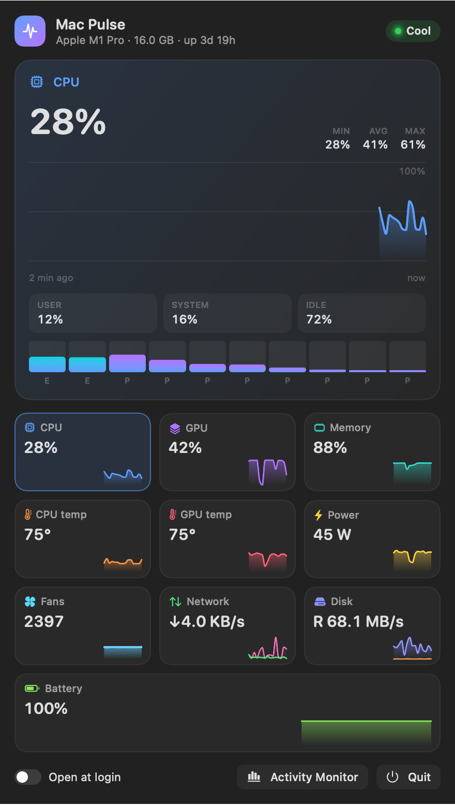
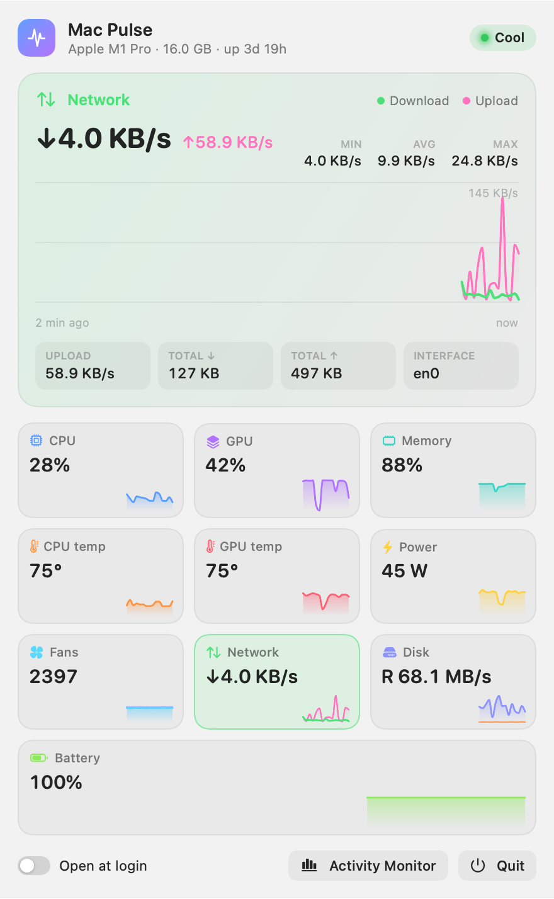

# Mac Pulse

A tiny, native macOS menu bar system monitor for Apple Silicon. Click the icon and see CPU, GPU, memory, temperatures, fans, power, network, disk and battery — each with its own live chart.

<p align="center">
  
  
</p>

## Features

- **Menu bar glyph** — a mini CPU history graph plus CPU % and CPU temperature, adapts to light/dark menu bar.
- **Hero chart** for the selected metric: 2 minutes of history, MIN / AVG / MAX and details
  (per-core P/E bars for CPU, renderer/tiler for GPU, app/wired/compressed/swap for memory, per-fan RPM, totals for network…).
- **Card grid** with a sparkline for every metric; click a card to make it the hero.
- Metrics: CPU, GPU, Memory, CPU temp, GPU temp, Power (system watts), Fans, Network (↓/↑), Disk (read/write), Battery.
- System thermal state pill, Open at login, quick link to Activity Monitor.
- Light and dark themes, ~1% CPU, no dependencies, no Dock icon.

## Requirements

- macOS 14+ on Apple Silicon (tested on M1 Pro, macOS 26)
- Swift 5.9+ (Xcode or just the Command Line Tools: `xcode-select --install`)

## Build & install

```bash
git clone https://github.com/maximus2526/mac-pulse.git
cd mac-pulse
./build.sh
```

`build.sh` builds a release binary, wraps it into `Mac Pulse.app`, signs it ad-hoc, copies it to `~/Applications` and launches it.

## How it reads the sensors

| Metric | Source |
| --- | --- |
| CPU, per-core | `host_processor_info` |
| GPU | `IOAccelerator` → `PerformanceStatistics` |
| Memory | `host_statistics64` + `vm.swapusage` |
| Temperatures | SMC keys `Tp*` / `Te*` (CPU) and `Tg*` (GPU), discovered at launch |
| Fans | SMC `FNum`, `F<n>Ac`, `F<n>Mn`, `F<n>Mx` |
| Power | SMC `PSTR` (system), `PDTR` (adapter), `PPBR` (battery) |
| Network | `getifaddrs` on `en*` interfaces |
| Disk | `IOBlockStorageDriver` statistics, free space from the root volume |
| Battery | `AppleSmartBattery` (percent, cycles, health, temperature) |

No root, no helper tools, no private frameworks beyond the public IOKit user clients.

## Snapshots (debug)

```bash
MACPULSE_SNAPSHOT=/some/dir .build/release/MacPulse
```

Renders the popover to PNGs (dark/light) after ~15 seconds of sampling and quits.

## License

MIT
